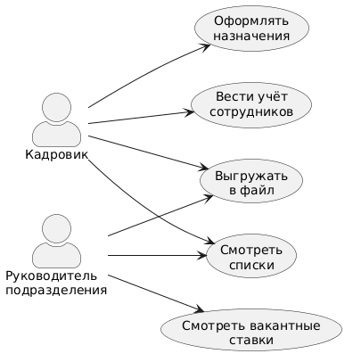
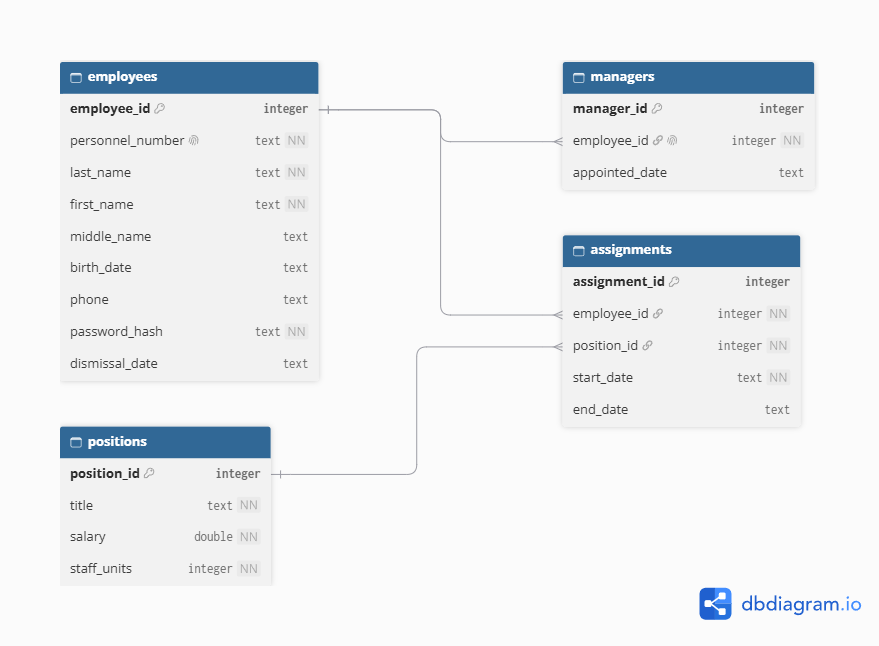

# StaffTrack
**Система учёта сотрудников и должностей.**

## Цели
- Хранение данных.
- Контроль штата.

## Роли
| Роль | Действие |
|------|----------|
| Кадровик | Учёт |

## Запуск
python src/main.py

## Автор
Ева Сорокина
## Диаграмма

## ER-диаграмма

### Сущности

| Сущность | Назначение | Ключи |
|---|---|---|
| `employees` | Сотрудники | **PK** employee_id |
| `positions` | Должности | **PK** position_id |
| `assignments` | Назначения | **PK** assignment_id, **FK** → employees, positions |

### Связи

- `employees` **1 : N** `assignments`
- `positions` **1 : N** `assignments`
- `employees` **M : N** `positions` (через `assignments`)
